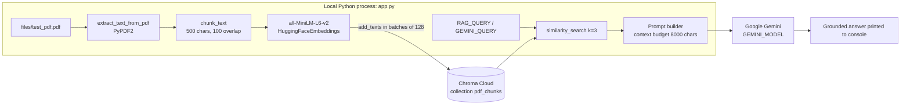
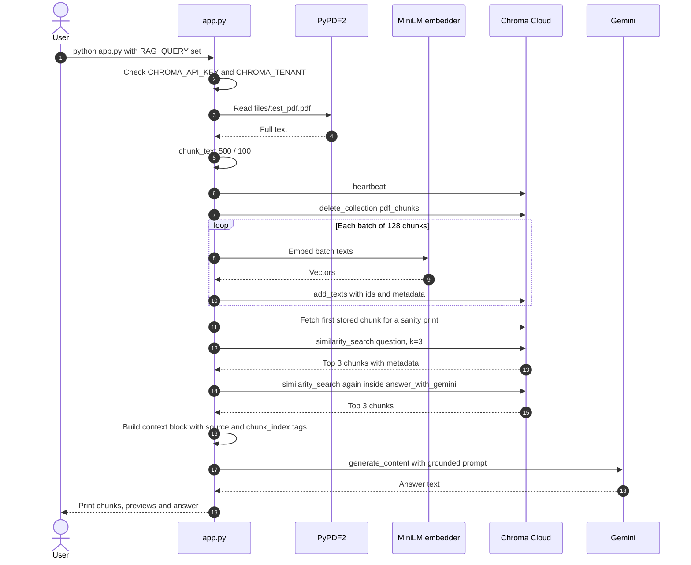
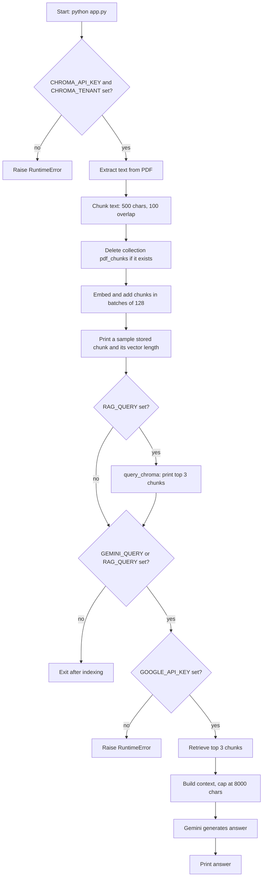

# RAG Document QA System: overview, system design and workflow

## Overview

### Problem

A large PDF is hard to search by hand, and a general-purpose LLM asked about it will either not know the content or
make something up. The goal is to answer questions about one specific document, using only what the document says.

### What it does

`app.py` is a single Python script that runs a 5-stage retrieval-augmented generation (RAG) pipeline:

1. **Extract**: read every page of a PDF with PyPDF2 and join the text.
2. **Chunk**: split the text into fixed 500-character windows with a 100-character overlap.
3. **Embed and store**: embed each chunk with the `all-MiniLM-L6-v2` sentence-transformer and write the chunks,
   vectors and metadata to a Chroma Cloud collection in batches of 128.
4. **Retrieve**: run a semantic similarity search for the top 3 chunks for a question.
5. **Answer**: send those chunks, tagged with their source and chunk index, to Google Gemini with a prompt that says
   to answer only from that context.

The sample input, `files/test_pdf.pdf`, is a synthetic 100-page document with one fictional employee profile per page.

## System design

### Components

| Component | Where | Role |
|---|---|---|
| PDF reader | `extract_text_from_pdf` (PyPDF2) | Turns the PDF into one text string, one page per line block. Pages with no extractable text are skipped. |
| Chunker | `chunk_text` | Sliding character window: size 500, overlap 100, so each window starts 400 characters after the last. Rejects a size of 0 or less and an overlap that is negative or not smaller than the size. |
| Embedding model | `HuggingFaceEmbeddings("all-MiniLM-L6-v2")` | Runs locally through `langchain-huggingface` and turns text into vectors. The README states 384 dimensions, and the script prints the stored vector length to confirm it. |
| Vector store | `chromadb.CloudClient` wrapped by `langchain_chroma.Chroma` | Hosted Chroma database (`CHROMA_DATABASE`, default `RAG`), collection `pdf_chunks`. Deleted and rebuilt on every run. |
| Retriever | `query_chroma` and `answer_with_gemini` | `similarity_search(query, k=3)` on the vector store. |
| LLM | `google.generativeai` | `GenerativeModel(GEMINI_MODEL)`, default `gemini-1.5-flash`. Needs `GOOGLE_API_KEY`. |
| Config | `.env` via python-dotenv | Keys and optional questions come from the environment. `.env` is git-ignored; `.env.example` lists the variables. |

### Architecture

### Data model

Each chunk is one record in the Chroma collection `pdf_chunks`.

| Field | Example or rule | Source in code |
|---|---|---|
| `id` | `test_pdf_pdf-0`, `test_pdf_pdf-1`, ... | `id_prefix` is the PDF file name with `.` replaced by `_`, plus the chunk index |
| `document` | Up to 500 characters of PDF text | `chunk_text` |
| `embedding` | Vector from `all-MiniLM-L6-v2` | Computed by the LangChain embedding function on write |
| `metadata.source` | Relative path of the PDF, for example `files/test_pdf.pdf` | `base_metadata` |
| `metadata.chunk_method` | `by_length` | `base_metadata` |
| `metadata.chunk_size` | `500` | `base_metadata` |
| `metadata.overlap` | `100` | `base_metadata` |
| `metadata.chunk_index` | 0-based position of the chunk | Added per chunk in `store_chunks_in_chroma` |

### Configuration

| Variable | Required | Default | Used by |
|---|---|---|---|
| `CHROMA_API_KEY` | yes | none | Chroma Cloud client |
| `CHROMA_TENANT` | yes | none | Chroma Cloud client |
| `CHROMA_DATABASE` | no | `RAG` | Chroma Cloud client |
| `GOOGLE_API_KEY` | for answers | none | `answer_with_gemini` |
| `GEMINI_MODEL` | no | `gemini-1.5-flash` | `answer_with_gemini` |
| `RAG_QUERY` | no | none | Retrieval preview in `query_chroma` |
| `GEMINI_QUERY` | no | falls back to `RAG_QUERY` | `answer_with_gemini` |

## Workflow

### One run of `python app.py`

### Pipeline flowchart

### Prompt contract

The Gemini prompt has three parts: `QUESTION`, `CONTEXT` and `INSTRUCTIONS`. The rules it gives the model:

- Answer using only the provided context.
- If the answer is not in the context, reply "I couldn't find that in the provided documents."
- Prefer exact numbers, names and facts from the context.
- If snippets disagree, say so briefly and pick the most consistent one.
- Keep the answer concise.

Each context snippet is labelled `[n] source=<path> chunk_index=<i>`, so the answer can be traced back to a chunk.

## Tech stack

| Tool | Used for | Why this and not the alternative |
|---|---|---|
| Python | Whole pipeline | Every library in the stack has a first-class Python client. |
| PyPDF2 | PDF text extraction | Pure Python and small. pdfplumber or PyMuPDF give better layout handling, but the sample PDF is plain text, so the simpler reader is enough. Neither does OCR on scanned pages. |
| Fixed-size character chunking | Splitting text | Simple, predictable and easy to explain. LangChain's `RecursiveCharacterTextSplitter` or sentence-aware splitting would respect word and sentence boundaries; a custom 15-line function keeps the logic visible. |
| `all-MiniLM-L6-v2` | Embeddings | Small, fast and free to run locally, with no per-call API cost. OpenAI or Gemini embedding APIs may retrieve better but add cost, latency and another key. |
| Chroma Cloud | Vector storage and search | Hosted, so the index lives outside the laptop and needs no server setup. FAISS is in-process only and has no metadata store; pgvector needs a Postgres instance. `chromadb.PersistentClient` would be the offline option. |
| LangChain (`langchain-chroma`, `langchain-huggingface`) | Glue between embedder and Chroma | `Chroma.add_texts` and `similarity_search` embed and query in one call. Calling the raw `chromadb` client would mean wiring the embedding function by hand. |
| Google Gemini (`google-generativeai`) | Answer generation | Free-tier API key from Google AI Studio and a fast default model. The model name is an environment variable, so it can be swapped without code changes. |
| python-dotenv | Configuration | Keeps keys out of the code and out of git. |

## Trade-offs and what to change at scale

| Current choice | Cost | At scale |
|---|---|---|
| The collection is deleted and rebuilt on every run | Every question pays for a full re-index; two runs against the same collection can collide | Split ingestion and query into separate commands or services; upsert by stable ID and only re-embed changed documents |
| One hardcoded PDF path | One document at a time | Ingest a folder or an upload endpoint; store one record per document with a document ID in metadata |
| Character windows ignore page and sentence boundaries | A chunk can cut a word or straddle two employee profiles | Page-aware or sentence-aware chunking, with page numbers in metadata for citations |
| Retrieval runs twice when both steps are enabled | The question is embedded and searched twice | Retrieve once and pass the hits to both the preview and the answer step |
| Fixed `k=3` with no score threshold | Weak matches still reach the prompt | Return scores, apply a cutoff, consider a re-ranker or hybrid keyword + vector search |
| No evaluation set | Retrieval quality is unmeasured: hit rate —, MRR — | A labelled question set and a script that reports hit rate and MRR per chunking setting |
| No error handling around the Gemini call | Rate limits or network errors end the run | Retries with backoff, timeouts and a clear error message |
| CLI only | Not usable by non-developers | A small FastAPI or Streamlit front end |
| `google-generativeai` SDK and a pinned default model name | Model names and SDKs change over time | Keep the model in config, pin dependency versions in a `requirements.txt` |

## Glossary

| Term | Meaning |
|---|---|
| RAG | Retrieval-augmented generation: fetch relevant text first, then ask the LLM to answer from it. |
| Chunk | A slice of the document text that is embedded and stored as one record. |
| Overlap | Characters shared between neighbouring chunks, so a fact on a boundary appears whole in at least one chunk. |
| Embedding | A fixed-length vector that represents the meaning of a piece of text. |
| Sentence-transformer | A model family that produces sentence-level embeddings; `all-MiniLM-L6-v2` is one. |
| Vector store | A database that stores embeddings and finds the nearest ones to a query vector. |
| Collection | Chroma's equivalent of a table; here `pdf_chunks`. |
| Tenant / database | Chroma Cloud's account and namespace levels above a collection. |
| Similarity search | Finding the stored vectors closest to the query vector. |
| Top-k | The number of nearest chunks returned; here 3. |
| Grounding | Restricting the LLM to the supplied context instead of its own training data. |
| Hallucination | An LLM answer that sounds right but is not supported by the source. |
| Context budget | The cap on how much retrieved text goes into the prompt; here 8000 characters. |
| Heartbeat | A cheap call that checks the Chroma server is reachable. |
