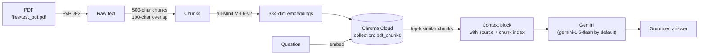

# RAG Document QA with Gemini

Ask questions about a PDF and get answers grounded in its content. The pipeline extracts the text, splits it into
overlapping chunks, embeds them with a Hugging Face sentence-transformer, stores them in **Chroma Cloud**, retrieves the
most relevant chunks for a question and has **Google Gemini** answer **using only that context**.

## How it works



| Step | Function in `app.py` | What it does |
|---|---|---|
| 1. Extract | `extract_text_from_pdf` | Reads every page with PyPDF2 and joins the text. |
| 2. Chunk | `chunk_text` | Fixed-size character windows (default 500) with overlap (default 100), so facts that straddle a boundary aren't lost. Validates the sizes. |
| 3. Embed and store | `store_chunks_in_chroma` | Embeds the chunks with `all-MiniLM-L6-v2` and writes them to Chroma in batches (default 128). Each chunk gets a stable ID and metadata (source, chunk index, size, overlap). The collection is rebuilt on every run, so results never mix with stale data. |
| 4. Retrieve | `query_chroma` | Similarity search for the top-k chunks, printed with metadata and a preview. |
| 5. Answer | `answer_with_gemini` | Builds a context block of the retrieved chunks (with a soft character budget) and prompts Gemini to answer **only from that context**. If the answer isn't there, Gemini says so instead of guessing. |

**Grounding rules in the prompt**
- Use only the provided context.
- Prefer exact numbers and names.
- Point out disagreements between chunks.
- Keep answers concise.
- Reply "I couldn't find that in the provided documents" when the context has no answer.

## Tech stack

Python · LangChain (`langchain-chroma`, `langchain-huggingface`) · ChromaDB (Chroma Cloud) · Hugging Face
sentence-transformers (`all-MiniLM-L6-v2`) · Google Gemini (`google-generativeai`) · PyPDF2 · python-dotenv

## Setup

```bash
git clone https://github.com/striderzz/RAG_Project1.git
cd RAG_Project1
python -m venv .venv
.venv\Scripts\activate          # macOS / Linux: source .venv/bin/activate
pip install PyPDF2 chromadb langchain-chroma langchain-huggingface sentence-transformers google-generativeai python-dotenv
```

Copy `.env.example` to `.env` and fill in your own values. `.env` is git-ignored, so never commit it:

| Variable | Required | Purpose |
|---|---|---|
| `CHROMA_API_KEY` | yes | Chroma Cloud API key |
| `CHROMA_TENANT` | yes | Chroma Cloud tenant ID |
| `CHROMA_DATABASE` | no (default `RAG`) | Chroma Cloud database name |
| `GOOGLE_API_KEY` | for answers | Gemini API key from Google AI Studio |
| `GEMINI_MODEL` | no (default `gemini-1.5-flash`) | Gemini model to use |
| `RAG_QUERY` | no | Question for the retrieval step |
| `GEMINI_QUERY` | no | Question for Gemini (falls back to `RAG_QUERY`) |

## Usage

Index the sample PDF and ask a question:

```bash
set RAG_QUERY=What is Yara Lopez's job title and salary?
python app.py
```

The run prints the following:
- the number of chunks created;
- the Chroma batches written;
- a sample stored chunk with its embedding size (384);
- the top-3 retrieved chunks with their metadata;
- Gemini's grounded answer.

To use your own document, put the PDF in `files/` and change `pdf_path` at the bottom of `app.py`. Change `chunk_size`
and `overlap` there to tune retrieval.

## Sample data

`files/test_pdf.pdf` is a **synthetic 100-page document**, one fictional employee profile per page (name, age, title,
salary, hobbies, height, weight). It was made for testing retrieval. Every name and number in it is dummy data.

## Possible next steps

- Page-aware or sentence-aware chunking, with page numbers in the metadata for citations.
- A small web UI (FastAPI or Streamlit) for uploading PDFs and chatting.
- Retrieval evaluation (hit rate / MRR) on a labelled question set.
- A local Chroma option (`chromadb.PersistentClient`) for offline use.
